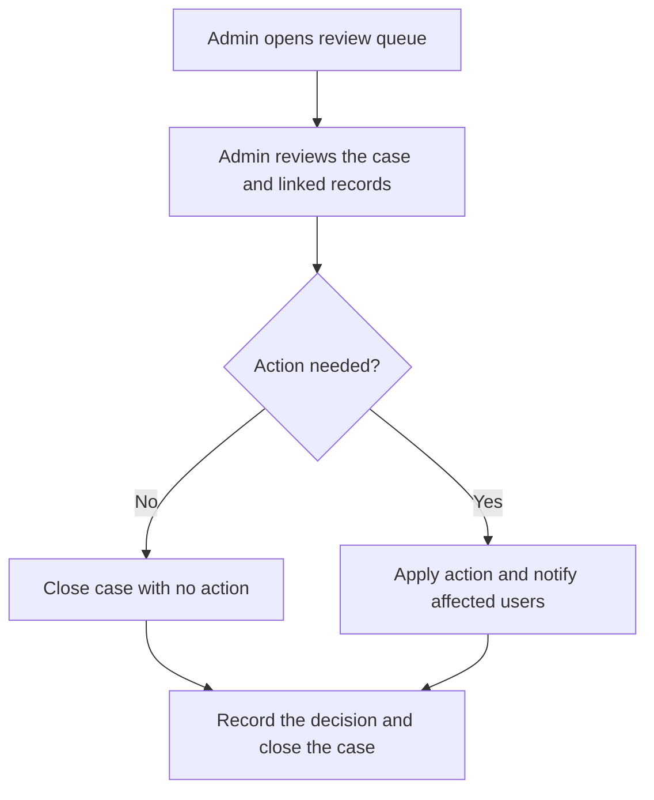

# Admin Workflow

[Admin Data Models](admin-data-models.md) · [All Data Models](data-models.md)

An `Admin` manages platform-wide issues such as flagged listings, user reports, and booking disputes. Admins also verify new hosts and reviewers before they can act.

## Onboarding

1. Admins aren't self-service. A `SuperAdmin` invites them by email.
2. The admin sets a password and must turn on multi-factor authentication before first sign-in.
3. The admin accepts the data-handling and youth-safety policy.

## Information the admin provides

- Name, work email, and an MFA device
- For every action: the decision and a written reason

## Actions

- Work the review queue: reports, disputes, safety concerns
- Verify or reject new `Host` and `Reviewer` accounts
- Approve new `Space` listings (`PendingApproval` → `Live`) or hide them
- Cancel a booking, for example for a safety issue or a venue emergency
- Pause, suspend, or reinstate accounts
- Adjust limits, such as a reviewer's maximum initiatives

## Rules and permissions

- Only `Admin` and `SuperAdmin` roles can open the queue.
- Admins can't act on a case they reported or one involving their own initiative.
- Every action needs a reason and creates an `AuditEntry`. Audit entries can't be edited.
- Safety concerns involving minors go to the top of the queue and must be picked up within 24 hours.
- Admins see personal data only for records linked to an open case.

## Data used at each step

| Step | Data used | Data saved or updated |
| --- | --- | --- |
| Open review queue | Signed-in user's admin role and open cases | None |
| Review case | Report reason, submitted details, and linked `Host`, `Space`, `Student`, `Initiative`, `Reviewer`, or `Booking` records | Set case status to `InReview` |
| Apply action | Case details and the admin's decision | Update the relevant record when needed, such as hiding a listing or suspending an account |
| Close case | Case ID, admin ID, action taken, and decision reason | Set case status to `Resolved` and save an audit entry with the decision and timestamp |

## Case statuses

`Open` → `InReview` → `Resolved`
