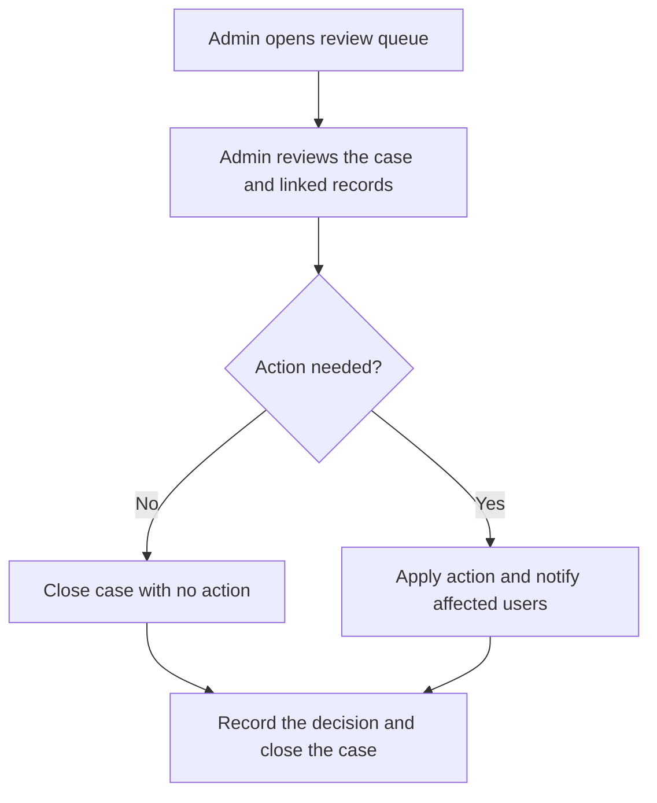

# Admin Workflow

An `Admin` manages platform-wide issues such as flagged listings, user reports, and booking disputes.

## Data used at each step

| Step | Data used | Data saved or updated |
| --- | --- | --- |
| Open review queue | Signed-in user's admin role and open cases | None |
| Review case | Report reason, submitted details, and linked `Host`, `Space`, `RenterOrganization`, or `Booking` records | Set case status to `InReview` |
| Apply action | Case details and the admin's decision | Update the relevant record when needed, such as hiding a listing or suspending an account |
| Close case | Case ID, admin ID, action taken, and decision reason | Set case status to `Resolved` and save an audit entry with the decision and timestamp |

## Case statuses

`Open` → `InReview` → `Resolved`
