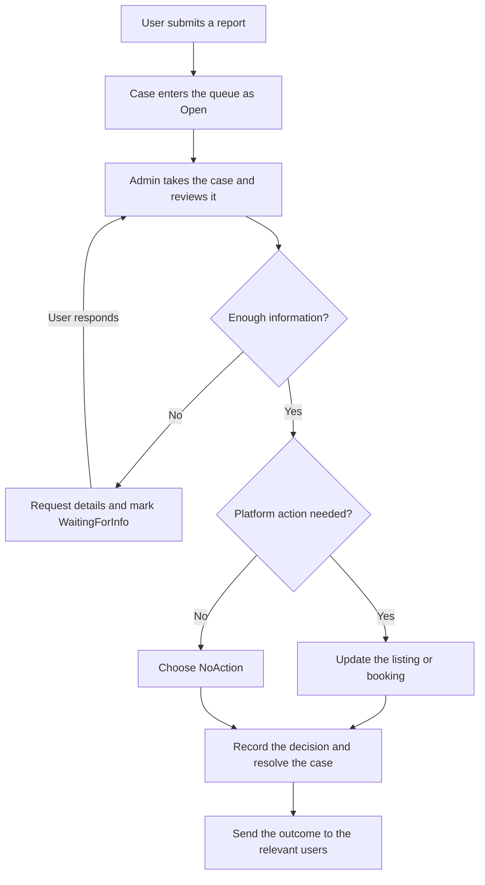

# Admin Dashboard and Workflow

Admins use this dashboard to review reported listings, account issues, and booking disputes. Each report becomes a `Case` that tracks the issue, who is handling it, and how it was resolved.

## Admin dashboard

| Page section | What the admin sees | What the admin can do |
| --- | --- | --- |
| Case queue | Case type, date reported, status, and assigned admin | Filter cases by type or status and open a case |
| Case details | Report reason, submitted details, linked records, and case history | Assign the case to themselves, review the details, or request more information |
| Decision panel | Available actions for the case type | Resolve with no action, hide a listing, or cancel a disputed booking when appropriate. Every decision requires a reason. |

## How the workflow works

1. **Receive a report.** A host or nonprofit submits a report. The app creates an `Open` case and links it to the listing, booking, or account involved.
2. **Take the case.** An admin assigns the case to themselves and moves it to `InReview`. The case page shows what was reported and the current state of the linked records.
3. **Ask for details if needed.** The admin sends a question and moves the case to `WaitingForInfo`. When the user responds, the case returns to `InReview`.
4. **Make a decision.** If the case needs action, the admin updates the relevant record. For example, hiding a listing removes it from search and prevents new requests. If no action is needed, the admin selects `NoAction`.
5. **Resolve the case.** The app records the decision, reason, admin ID, and timestamp. It marks the case `Resolved` and sends the relevant users a summary of the outcome.

## Data used at each step

| Step | Data read | Data saved or updated |
| --- | --- | --- |
| Receive report | Reporter ID, report type, description, and linked record IDs | Create a `Case` with status `Open` |
| Review case | Admin role, report details, case history, and linked records | Save `assignedAdminId` and set status to `InReview` |
| Request more details | Case ID and the recipient's user ID | Save the question and set status to `WaitingForInfo` |
| Make a decision | Case details, current listing or booking status, and decision reason | Update the linked record when the decision requires it |
| Resolve case | Case ID, admin ID, decision, and reason | Set status to `Resolved`, save an `AuditEntry`, and send an outcome notification |

## Example

A teen nonprofit reports that a listing says it holds 50 people, but the host confirms the room only holds 25. An admin reviews the report, hides the listing, and records the reason. The host gets a message explaining what to correct, and the nonprofit gets an update that the report was resolved.
