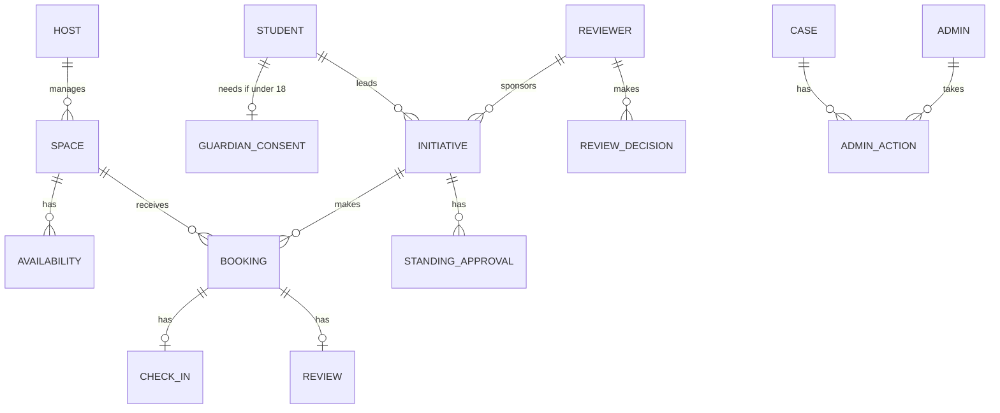

# YouthSpaceFinder Data Models (Overview)

Role details: [Host](host-data-models.md) · [Student](student-data-models.md) · [Reviewer](reviewer-data-models.md) · [Admin](admin-data-models.md)

## Status enums in one place

| Entity | Statuses |
| --- | --- |
| Student | `PendingGuardian`, `Active`, `Paused`, `Suspended` |
| Host | `PendingVerification`, `Verified`, `Suspended` |
| Reviewer | `PendingVerification`, `Verified`, `Suspended` |
| Space | `Draft`, `PendingApproval`, `Live`, `Hidden` |
| Initiative | `PendingReview`, `Approved`, `ChangesRequested`, `Rejected`, `Archived` |
| Booking | `Draft`, `PendingReview`, `PendingHost`, `Confirmed`, `Declined`, `Cancelled`, `Completed`, `NoShow` |
| Case | `Open`, `InReview`, `Resolved` |

## Who can change a booking's status

| From → To | Who |
| --- | --- |
| `Draft` → `PendingReview` | Student |
| `PendingReview` → `PendingHost` or `Declined` | Reviewer (skipped if a `StandingApproval` matches) |
| `PendingHost` → `Confirmed` or `Declined` | Host |
| any pending or `Confirmed` → `Cancelled` | Student, Host, or Admin |
| `Confirmed` → `Completed` or `NoShow` | System, after the end time, based on `CheckIn` |
