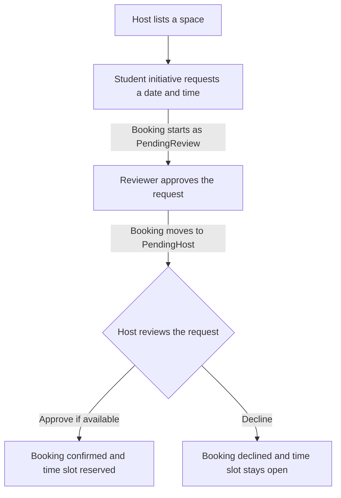

# Host Workflow

[Host Data Models](host-data-models.md) · [All Data Models](data-models.md)

A `Host` is a venue, such as a library, church, community center, or parks department, that offers spaces to student initiatives.

## Onboarding

1. Host signs up with name, email, and organization name.
2. Host provides proof that they manage the venue, such as an organization email domain, a website, or a staff contact.
3. Account stays `PendingVerification` until an Admin verifies it.
4. Host creates a space. The first listing goes to Admin as `PendingApproval` before it's `Live`.

## Information the host provides

- Organization name, address, contact person, and phone
- For each space: name, type (library room, church hall, park shelter), address, capacity, photos, amenities, price (free or a fee), house rules, and accessibility details
- Availability: recurring open hours and blocked dates
- Booking settings: minimum notice, auto-approve on or off

## Actions

- Create, edit, hide, or delete spaces
- Set and update availability
- Approve or decline requests in `PendingHost`
- Turn on auto-approve for trusted initiatives
- Cancel a confirmed booking with a reason (for example, a venue emergency)
- Message the student and reviewer about a booking
- Report a problem to Admin

## Rules and permissions

- Only `Verified` hosts can publish spaces.
- A host can only manage spaces where `Space.hostId` matches their ID.
- A host only sees requests that a reviewer has approved (`PendingHost`), not drafts.
- Approval is blocked if the time overlaps a `Confirmed` booking or falls outside availability.
- Hosts see the initiative name, the lead's first name, and the adult on site. They don't see students' contact details or dates of birth.
- Cancelling a confirmed booking within 24 hours of the start requires a reason and is reported to Admin.
