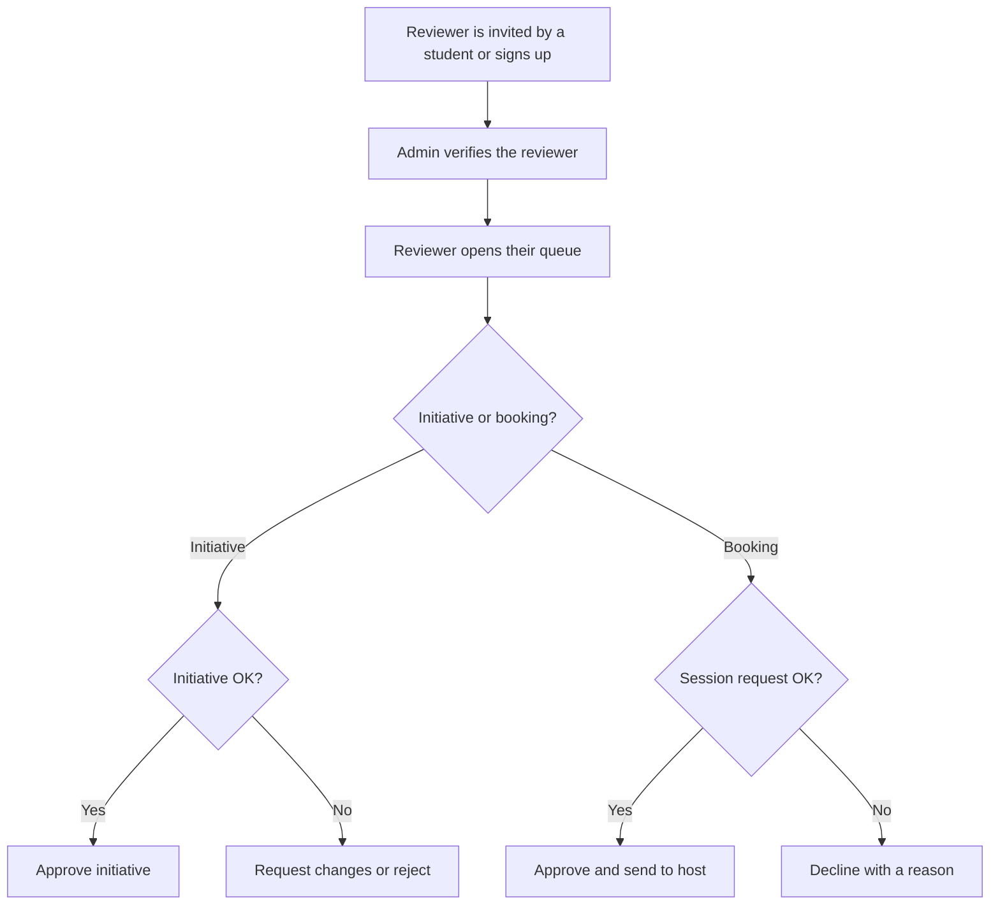

# Reviewer Workflow

[Reviewer Data Models](reviewer-data-models.md) · [All Data Models](data-models.md)

A `Reviewer` is a trusted adult sponsor, such as a teacher, club advisor, nonprofit mentor, or parent volunteer. Reviewers vet student initiatives and session requests before hosts see them, and they're accountable for having an adult on site. This keeps hosts from having to judge requests from minors on their own.

## 1. Onboarding

1. A student names the reviewer's email when creating an initiative, or the reviewer signs up directly.
2. The reviewer creates an account and enters their role and affiliation.
3. The reviewer accepts the code of conduct and youth-safety policy.
4. The account stays `PendingVerification` until an Admin verifies their affiliation, for example through a school email domain or a reference.
5. Once `Verified`, the reviewer sees initiatives and booking requests assigned to them.

## 2. Information the reviewer provides

| When | Information |
| --- | --- |
| Sign-up | Name, email, phone, role (teacher, advisor, mentor, parent volunteer), affiliation (school or organization) |
| Verification | Work email or reference contact; background-check confirmation if the affiliation requires it |
| Reviewing | Decision, reason or requested changes, and the adult on site if it isn't the reviewer |

## 3. Actions

- See a queue of initiatives and booking requests assigned to them
- Approve, request changes to, or reject an initiative
- Approve or decline a session request, which sends it to the host or back to the student
- Assign another verified adult as the on-site adult for a session
- Set a recurring approval, such as "weekly Tuesday sessions at the same space through June", so repeat requests skip review
- Withdraw sponsorship from an initiative, which cancels its future bookings after notice
- Report a concern to Admin

## 4. Rules and permissions

- Only `Verified` reviewers can approve anything.
- A reviewer can act only on initiatives where they are the assigned reviewer.
- A reviewer can't approve a booking that conflicts with availability or exceeds capacity. The system blocks it.
- Reviewers must respond within 48 hours. Requests with no response go back to the student with a reminder to pick another reviewer.
- A reviewer can sponsor at most 10 active initiatives (Admin can raise this).
- Reviewers see student contact details only for their own initiatives.
- Every decision is logged with a timestamp and reason.

## 5. How actions move through the system

- **Initiative:** `PendingReview` → `Approved`, `ChangesRequested` (student edits and resubmits), or `Rejected`
- **Booking:** `PendingReview` → `PendingHost` (reviewer approves) or `Declined` (reviewer declines)
- Approving a booking notifies the host and the student. Declining notifies the student with the reason.
- Withdrawing sponsorship sets the initiative to `Archived` and its future bookings to `Cancelled`, and notifies hosts and students.

## 6. Data used at each step

| Step | Data used | Data saved or updated |
| --- | --- | --- |
| Sign up | Name, email, role, affiliation | Create `Reviewer` with status `PendingVerification` |
| Verification (Admin) | Affiliation evidence | Set `Reviewer.status` to `Verified` |
| Review an initiative | `Initiative`, lead `Student` | Set `Initiative.status`; create `ReviewDecision` |
| Review a booking | `Booking`, `Space`, `Availability`, `Initiative` | Set `Booking.status` to `PendingHost` or `Declined`; create `ReviewDecision` |
| Recurring approval | Initiative ID, space ID, pattern, end date | Create `StandingApproval` |
| Withdraw sponsorship | Initiative ID and reason | Archive the initiative, cancel future bookings |
