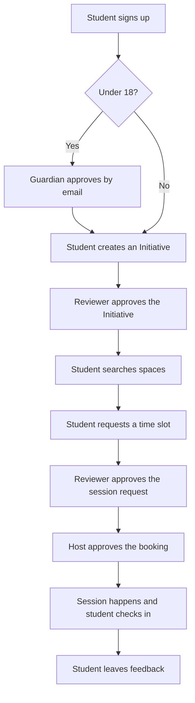
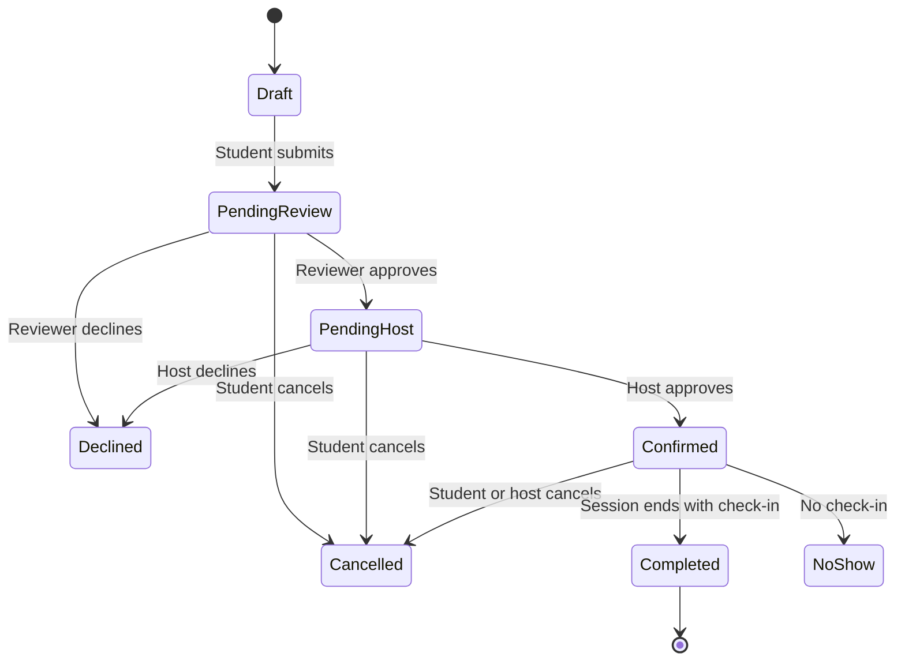

# Student Workflow

[Student Data Models](student-data-models.md) · [All Data Models](data-models.md)

A `Student` leads an initiative (a study group, club, workshop, or service project) and books community spaces such as libraries, churches, and parks to run sessions.

## 1. Onboarding

1. Student signs up with an email address and verifies it.
2. Student enters their profile details: name, date of birth, school, and grade.
3. If the student is under 18, the app emails their guardian. The account stays `PendingGuardian` until the guardian approves.
4. The account becomes `Active`, and the student can create an initiative.

Students under 13 aren't supported in version 1. Supporting them would require verifiable parental consent under COPPA.

## 2. Information the student provides

| When | Information |
| --- | --- |
| Sign-up | Name, email, date of birth, school, grade, city or ZIP |
| Guardian consent (under 18) | Guardian name, guardian email, guardian phone |
| Create an initiative | Title, description, category (study, club, service, arts, sports), expected group size, age range, and the email of a Reviewer (adult sponsor) |
| Request a booking | Space, date, start and end time, session purpose, attendee count, adult on site, and any equipment needed |

## 3. Actions

- Create, edit, and archive their initiatives
- Invite co-leads (other students) to an initiative
- Search spaces by location, date, capacity, type (library, church, park), and price (free first)
- Request a booking, edit it before review, or cancel it
- See booking status and any messages from the host or reviewer
- Check in at the start of a session
- Leave a rating and feedback for the space after the session
- Report a problem with a space or host, which creates a `Case` for Admin

## 4. Rules and permissions

- The student must have an `Active` account. Under-18 accounts need guardian approval.
- The student must be the lead or a co-lead of an `Approved` initiative before booking.
- Every booking needs a named adult (the Reviewer or someone they assign) present on site.
- Attendee count can't exceed the space's capacity.
- The requested time must fall inside the space's open `Availability` and can't overlap a `Confirmed` booking.
- Limits: at most 3 pending requests at a time, and requests must be made at least 72 hours ahead (hosts can override the notice period).
- A student can cancel without penalty up to 24 hours before the session. Three no-shows lead to a temporary booking pause.
- Students can't see other students' personal details, and hosts only see the initiative name, the lead's first name, and the adult on site.

## 5. How actions move through the system

Each status change sends a notification to the student, the reviewer, and (from `PendingHost` onward) the host.

## 6. Data used at each step

| Step | Data used | Data saved or updated |
| --- | --- | --- |
| Sign up | Email, name, date of birth, school | Create `Student` with status `PendingGuardian` or `Active` |
| Guardian consent | Guardian contact and consent token | Create `GuardianConsent` and set `Student.status` to `Active` |
| Create an initiative | Initiative details and Reviewer email | Create `Initiative` with status `PendingReview` |
| Search spaces | Filters, `Space`, `Availability`, `Booking` (confirmed only) | None |
| Request a booking | Space ID, initiative ID, times, purpose, attendee count, adult on site | Create `Booking` with status `PendingReview` |
| Cancel | Booking ID and reason | Set `Booking.status` to `Cancelled` |
| Check in | Booking ID, time, location | Create `CheckIn` |
| Feedback | Booking ID, rating, comment | Create `Review` |
| Report a problem | Reason and linked records | Create `Case` with status `Open` |
